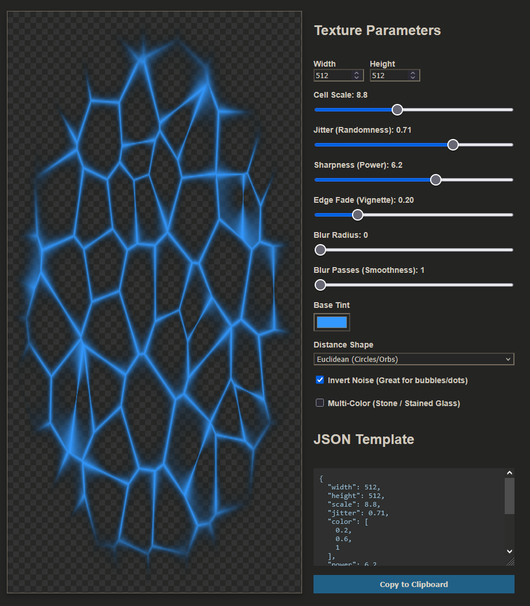

# WebGL Procedural Texture Generator
A lightning-fast, GPU-accelerated procedural texture generator built with TypeScript and WebGL. 

This tool is designed specifically for game developers and VFX artists who need to generate highly customizable, seamless, and performant textures for particle systems, shields, terrain foundations, and UI elements. Instead of saving massive image files, this tool outputs a lightweight JSON configuration that your game engine can use to reproduce the texture procedurally at runtime.

### Warning: THIS IS A ~~ONE~~2-HOUR AI SLOP!

<p align="center">
  
</p>

## 🚀 Features

* **Real-Time GPU Generation:** Harnesses WebGL fragment shaders to calculate per-pixel noise instantly, providing a buttery-smooth UI experience.
* **Cellular / Voronoi Noise:** Generates organic, cell-like structures perfect for cracked earth, scales, water caustics, and magic bubbles.
* **Shape Metrics:** Swap between Euclidean (circular/organic) and Manhattan (diamond/crystalline) distance algorithms. 
* **Advanced Masking:** Built-in edge fading (vignetting) to create perfect alpha-masked particle billboards.
* **Multi-Pass Ping-Pong Blurring:** Implements a highly optimized FBO ping-pong rendering technique to achieve smooth, large-radius blurs without tanking performance. 
* **JSON Export:** Instantly copy the exact mathematical state of your texture to the clipboard for ingestion into your game engine.

## Use-cases
Cellular (Voronoi) noise is essentially the Swiss Army knife of procedural texturing. Because your generator outputs mathematically precise grayscale data (along with your multi-color additions), you aren't just creating "pictures" to slap onto a wall. You are generating data maps—Height, Roughness, Emission, and Alpha masks—that tell a 3D material exactly how to interact with light and geometry.

### 1. Environment & Terrain (Displacement & Bump Maps)
By feeding the grayscale output of your generator into the height or displacement channel of a 3D material, you actually alter the physical geometry (or the illusion of it) in the engine.

* **Cracked Mud / Desert Earth:** * *Settings:* Euclidean, Invert OFF, high Sharpness, low/no Blur.
* *Usage:* The dark lines become deep crevices, and the white centers become the flat plates of dry dirt.

* **Cobblestone Streets & Mosaics:** * *Settings:* Euclidean, Multi-Color ON, moderate Scale.
* *Usage:* Use the multi-color output for the Albedo (Base Color), and the grayscale output as a normal/bump map to make the mortar between the stones look recessed.

* **Organic Surfaces (Leather, Reptile Scales, Sponge):**
* *Settings:* Euclidean, Invert ON, slight Jitter, very slight Blur.
* *Usage:* Inverted Voronoi creates overlapping, bulbous spheres instead of flat cells. This is perfect for the bumpy surface of a dragon's skin or the porous surface of a sea sponge.

### 2. VFX & Magic (Emission & Alpha Maps)
This is where your **Edge Fade** and **Manhattan Distance** knobs really shine. By mapping the texture to the Emission (glow) and Alpha (transparency) channels of an unlit shader, you get incredibly cheap, dynamic effects.

* **Sci-Fi Energy Shields / Holograms:**
* *Settings:* Manhattan Distance, Invert OFF, neon Base Tint, sharp Power.
* *Usage:* Manhattan distance gives you that techy, angular, crystalline look. Map this to a spherical mesh, crank up the emission in your game engine, and pan the UV coordinates over time to make the shield energy "flow."

* **Water Caustics (Pool Reflections):**
* *Settings:* Euclidean, Invert ON, high Blur Passes, sharp Power.
* *Usage:* If you look at the bottom of a swimming pool, the dancing light patterns are literally just inverted, blurred Voronoi noise.  You can project this texture over your underwater environment as a light decal.

* **Magic Projectiles & Sparks:**
* *Settings:* Manhattan or Euclidean, Invert ON, Edge Fade > 0.5.
* *Usage:* The edge fade creates a perfect circular mask, making this a ready-to-use particle billboard. Spawn hundreds of these on camera-facing quads to create a burst of magical energy or floating embers.

### 3. Surface Imperfections (Roughness Maps)
Nothing in the real world is perfectly smooth or clean. Using noise to break up how light reflects off a surface is the secret to photorealism.

* **Hammered Metal / Dented Armor:**
* *Settings:* Euclidean, Invert ON, very high Scale (lots of cells), soft Blur.
* *Usage:* Feed this into the Roughness or Normal map of a metallic material. It will make the metal look like it has been repeatedly struck by a blacksmith's hammer.

* **Stained Glass Windows:**
* *Settings:* Manhattan or Euclidean, Multi-Color ON, Jitter 0 (perfect grid) or slightly jittered.
* *Usage:* Map the base colors to the glass, and use the dark grid lines as the metallic lead framing (using a metallic map).


## 🧠 Technical Details

This project is inspired by the highly optimized software-rendering techniques used in the demoscene (e.g., Farbrausch's Werkkzeug), but adapted for modern GPU architecture.

Instead of relying on CPU-bound spatial subdivision grids or tree-traversals to find neighboring cells, this generator evaluates the 2nd-order Voronoi diagram completely in parallel within a WebGL Fragment Shader. 

To achieve smooth gradients (approximating a Gaussian blur) without the quadratic cost of a massive 2D convolution kernel, the engine uses **Ping-Pong Framebuffers (FBOs)**. The crisp noise is rendered to an off-screen texture, which is then bounced back and forth between two FBOs—blurring horizontally in one pass, and vertically in the next. Multiple passes result in a buttery-smooth blur at a fraction of the computational cost.

## 💻 Installation & Setup

This project uses **Vite** as its build tool for instant server start and lightning-fast Hot Module Replacement (HMR).

### Prerequisites
* [Node.js](https://nodejs.org/) (v16 or higher recommended)
* NPM or Yarn

### Running Locally

1. **Clone the repository:**
   ```bash
   git clone [https://github.com/romland/procedural-textures.git](https://github.com/romland/procedural-textures.git)
   cd procedural-textures

```

2. **Install dependencies:**
```bash
npm install

```


3. **Start the development server:**
```bash
npm run dev

```


*The console will output a local URL (usually `http://localhost:5173`). Open this in your browser to use the tool.*
4. **Build for production:**
```bash
npm run build

```


*This compiles the TypeScript and minifies the assets into the `dist/` folder, ready to be hosted on any static web server.*

## 🎮 How to Use (For Users & Artists)

1. **Tweak the Knobs:** Use the right-hand panel to adjust the resolution and noise parameters.
* **Jitter:** Controls how uniform the grid is. `0` is a perfect grid, `1.0` is highly chaotic.
* **Sharpness (Power):** Increases the contrast of the cell edges.
* **Multi-Color:** Assigns a pseudo-random hash to each cell to generate stained glass or cobblestone variations.


2. **Smooth it Out:** Increase the **Blur Radius** and **Blur Passes** to soften hard edges. This is excellent for creating volumetric smoke or soft magic glows.
3. **Export to Game:** Once you have the perfect texture, click **Copy to Clipboard**.

### Game Engine Integration

This tool is designed to bypass the need to download `.png` files. In your game engine (whether it's a custom WebGL engine, Three.js, or Babylon.js), simply parse the exported JSON:

```json
{
  "width": 512,
  "height": 512,
  "scale": 5.0,
  "jitter": 0.8,
  "color": [0.2, 0.6, 1.0],
  "power": 3.5,
  "invert": false,
  "edgeFade": 0.5,
  "distanceType": 0,
  "multiColor": false,
  "blurRadius": 4,
  "blurPasses": 2
}

```

You can port the `Shaders.ts` and `TextureEngine.ts` classes directly into your engine. Feed this JSON object into the `render()` method during your game's loading screen to generate the texture asset entirely on the player's GPU in milliseconds!

```
